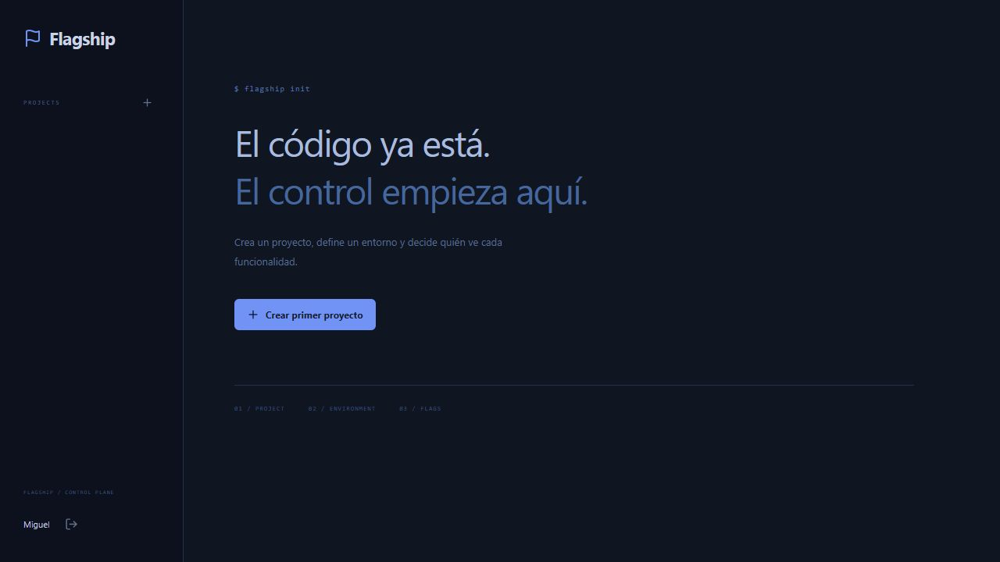

# Flagship

Self-hosted feature flags, deterministic rollouts, scoped API keys and a server-side JavaScript SDK.

[](https://github.com/MIGUEL-MOSCOSO-DEV/flagship/actions/workflows/ci.yml) · [Licencia MIT](LICENSE)

Control de funcionalidades para desplegar con calma. Separa las reglas por entorno, activa cambios graduales y consulta quién modificó cada configuración.



## Qué puedes hacer

- Proyectos y entornos independientes, sin configuraciones precargadas.
- Flags booleanas con porcentaje de exposición y lista de identificadores permitidos.
- Distribución determinista, configuración versionada y rechazo de cambios simultáneos.
- Claves limitadas a un entorno, revocación, auditoría y SDK JavaScript para servidor.

## Ponerlo en marcha

Necesitas Node.js 22.13 o superior y npm. Se recomienda Node 22 LTS. SQLite viene integrado en Node; no necesitas otro servicio de base de datos.

```sh
git clone https://github.com/MIGUEL-MOSCOSO-DEV/flagship.git
cd flagship
npm ci
npm run dev
```

Abre http://localhost:3800 y crea tu cuenta. La instalación comienza vacía: no hay usuarios, contraseñas compartidas ni registros de demostración.

Crea un proyecto, un entorno y una flag. Configura su regla y emite una clave. La clave completa se muestra una sola vez: guárdala en el servidor de tu aplicación. Prueba la evaluación en SDK & playground.

## Configuración

Puedes copiar `.env.example` a `.env`. El servidor lo lee al iniciar.

- `PORT`: puerto del servidor; 3800 por defecto.
- `HOST`: interfaz de escucha; `127.0.0.1` por defecto.
- `APP_URL`: dirección pública completa para enlaces y validación del origen.
- `DATABASE_PATH`: archivo SQLite; por defecto `./data/flagship.sqlite`.

Las rutas relativas parten del directorio desde el que ejecutas el proyecto. No publiques `.env` ni los datos.

## Ejecutar en un servidor

```sh
npm ci
npm run build
npm start
```

Configura `APP_URL` con tu dominio HTTPS y coloca el proceso detrás de un proxy inverso que termine TLS. Ajusta `HOST` si tu infraestructura necesita otra interfaz. Mantén Node activo con un gestor de servicios y conserva el directorio de datos entre despliegues. La base necesita almacenamiento persistente.

Las sesiones usan cookies HTTP-only y las contraseñas se almacenan con scrypt. Las rutas privadas comprueban la cuenta propietaria y hay validación de entradas y límites de solicitudes. El registro de cuentas está abierto: quien acceda al servidor puede crear su propio espacio. No incluye recuperación de contraseña por correo ni gestión de miembros.

## Datos y copias de seguridad

Detén el proceso antes de copiar la base SQLite y sus archivos asociados, o realiza una copia coherente con herramientas de SQLite. Guarda las copias fuera de la carpeta pública y comprueba su restauración. `data/`, `.env` y las dependencias están excluidos de Git.

## Intercambio e integración

POST /api/evaluate/:flagKey recibe JSON con `key`, el identificador estable del sujeto, y requiere la clave del entorno en Authorization: Bearer. Nunca expongas esa clave al navegador. El cliente está en sdk/client.js y se descarga desde el panel. Su caché dura 30 segundos por defecto, admite hasta 1000 entradas y las solicitudes tienen un límite de cinco segundos. Consulta su código y pruebas para integrar FlagshipClient y variation.

## Alcance actual

Las flags sin configurar o deshabilitadas devuelven false. La lista permitida solo funciona con la regla habilitada. Las claves evalúan y no administran. El SDK devuelve false por defecto ante fallos; revocar una clave no borra los resultados que un cliente conserva en caché.

## Desarrollo y pruebas

```sh
npm run check
npm run format:check
npm test
npm run build
```

Distribución estable, precedencia de reglas, alcance y revocación de claves, conflictos de versión, auditoría y fallos del SDK. Las pruebas crean datos temporales y los eliminan al terminar.

React construye la interfaz, Express expone la API y SQLite conserva los datos. `src/` contiene las pantallas, `server/` la lógica y persistencia, `shared/` las reglas compartidas y `tests/` las verificaciones. GitHub Actions ejecuta los controles en cada cambio de la rama principal.

## Contribuir

Abre un issue con los pasos para reproducir el error y el comportamiento esperado. No adjuntes credenciales, archivos privados ni bases de datos. Para proponer cambios, explica qué resuelven y añade pruebas cuando afecten reglas de negocio.

Creado por [Miguel Moscoso](https://github.com/MIGUEL-MOSCOSO-DEV). Licencia MIT.
